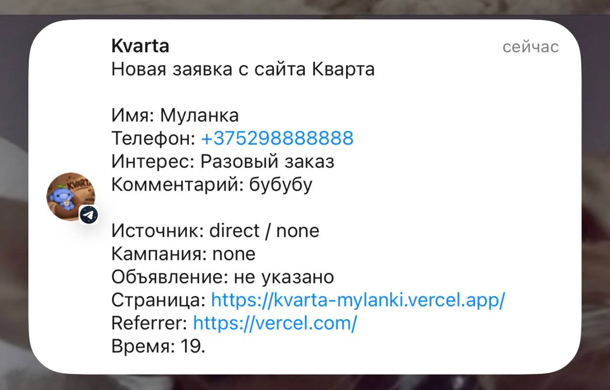
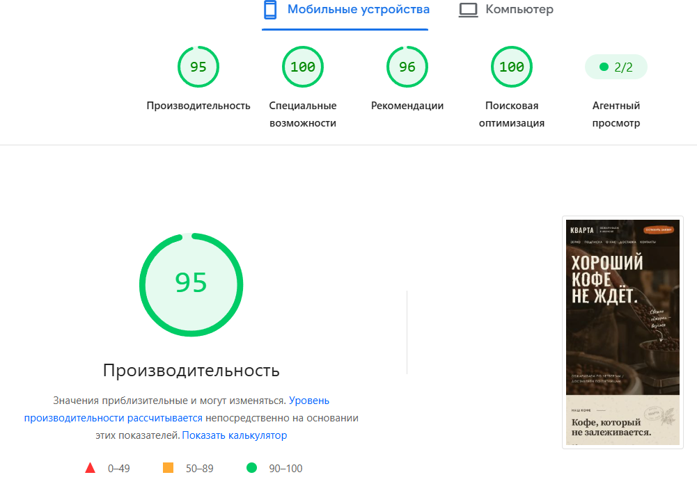

# Кварта

Лендинг для небольшой минской обжарки кофе, тестовое задание.
Живой сайт: https://kvarta-mylanki.vercel.app

Next.js (App Router), TypeScript, Tailwind CSS, хостинг на Vercel.

## Что внутри

Первый экран, ассортимент с каруселью (на компьютере видно три пачки, дальше они сменяются по одной), блок про основателей и подписку, доставка и самовывоз, контакты и форма заявки в модальном окне. Цены, адрес и часы работы взяты из брифа, абзацы текста я переписала под тон «тепло и просто», фото сгенерированы нейросетью.

## Форма и бэкенд

Заявка уходит на `POST /api/lead`.

- Имя: только буквы. Телефон: белорусский, проверяется код оператора, хранится в виде `+375XXXXXXXXX`. Неверный номер не принимается, под полем есть подсказка.
- Повтор того же номера в течение 10 минут новую заявку не создаёт, двойной клик тоже. Номер «занимается» в Upstash Redis одной атомарной командой, поэтому это работает, даже если сайт крутится в нескольких экземплярах. Без ключей Upstash лимит считается в памяти.
- Откуда пришёл клиент: `utm_source`, `utm_medium`, `utm_campaign`, `utm_content`, referrer и адрес страницы запоминаются при первом заходе и уходят вместе с заявкой.
- Если отправка не удалась, человек видит понятное сообщение, а введённые данные в форме остаются.
- От спама: Cloudflare Turnstile, скрытое поле-ловушка, лимит запросов с одного IP, проверка Origin.

## Куда складываются заявки

В `leads.json` и дублируются в Telegram-бот. JSON выбрала потому, что для тестового не хотелось тащить базу: ничего не надо настраивать, файл легко открыть. Но на Vercel файловая система только для чтения, поэтому на живом сайте заявка доходит через Telegram, а файл не пишется. В настоящем проекте я бы взяла Turso или Supabase.

## Что делала я, а что ИИ

Я самостоятельно спроектировала архитектуру проекта на Next.js и TypeScript и сверстала адаптивный интерфейс с использованием Tailwind CSS. Написала серверную логику для обработки заявок с валидацией данных и ограничением частоты отправок. Настроила интеграцию с Telegram для мгновенного получения уведомлений и добавила сбор меток для аналитики. Реализовала защиту от спама и переполнения хранилища. Искусственный интеллект помогал мне лишь с мелкими правками на фронтенде, генерацией изображений и базовых шаблонов кода. Все ключевые архитектурные решения и интеграции выполнены мной лично, потому что проще сделать самой, чем дождаться пока любимый клод начнет работать, а не токены жрать 

## Где ИИ ошибся и как я заметила

Иишка выдумывала несуществующие файлы шрифтов, что приводило к падению сборки на сервере, но я быстро нашла причину в логах и заменила их на облачные шрифты. Игнорировала особенности облачного хостинга и не оборачивала запись файлов в блок обработки ошибок, что могло бы полностью положить сайт, поэтому я сама добавила защиту от сбоев. Также она генерировала кривые векторные стрелки и использовала время UTC вместо минского, поэтому заявки приходили бы с неверным временем. Мне приходилось постоянно отлавливать эти слепые генерации и переписывать код, потому что ИИ просто копирует шаблоны.

## Допущения

- Сколько стоит доставка при заказе меньше 50 BYN, в брифе не сказано, поэтому на сайте этого нет.
- Телефона и email клиента в брифе нет, в контактах только адрес и часы работы.
- Согласие на обработку данных сделано обычной галочкой без ссылки: страницы с политикой нет.

## Что не успела или сделала бы иначе

- Заявки лучше хранить в нормальной базе, а не в JSON.
- Лимиты в Upstash стоило бы проверить под нагрузкой.
- В политике безопасности (CSP) остался `unsafe-inline`: без него Next не запускает свои скрипты, а на строгую версию с nonce времени не хватило.

### Уведомление в Telegram


### Оценка Lighthouse


## Запуск

```
npm install
npm run dev
```

